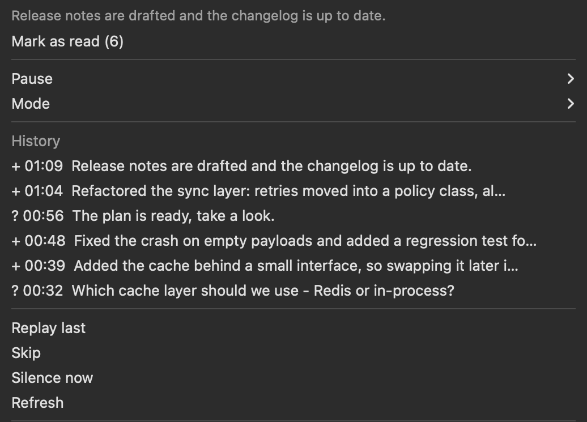

# cvoice

Claude Code tells you when it needs you.

You start a long task, switch to the browser, and then keep checking the terminal to see
whether it finished or is quietly waiting for an answer. `cvoice` removes the
checking: a banner when it asks something, a spoken one-line summary when a turn ends, and
a menu-bar item that keeps everything it said so you can hear it again later.

**macOS only.** It builds on `say`, `afplay`, `terminal-notifier` and SwiftBar.



---

## What it does

| When | What you get |
| --- | --- |
| Claude asks a question or presents a plan | The question itself, immediately |
| A turn ends | A one or two sentence summary — what was done, what matters next |
| It is waiting for a permission decision | Which tool it is blocked on |
| You start typing again | Whatever it still wanted to say is dropped |

It does not read the reply out loud. A forty-line answer full of code and file paths is
unlistenable, so a cheap model condenses it first. Short replies already in your language
are read as they are, and cost nothing.

## Install

```bash
git clone https://github.com/<you>/cvoice
cd cvoice
./install.sh
```

The installer creates its own virtual environment, writes a small shim, and wires the hooks
into every Claude Code config directory it finds — backing up each `settings.json` first.
Nothing is installed globally.

```bash
cvoice doctor    # checks dependencies, hooks, permissions, Focus state
```

## Modes

| Mode | Behaviour |
| --- | --- |
| `off` | Silent |
| `notify` | macOS banner only |
| `voice` | Spoken only |
| `both` | Banner and speech |

Modes are set per scope, and the most specific one wins — **project > alias > global**:

```bash
cvoice mode voice                    # everywhere
cvoice mode off --scope alias        # only this Claude alias
cvoice mode both --scope project     # only this directory
```

Project settings are stored centrally, never inside your repositories.

## Everyday commands

```bash
cvoice status         # what is on right now, and any degraded component
cvoice snooze 30      # silence for 30 minutes, expires by itself
cvoice resume
cvoice history        # everything it has told you, with ids
cvoice play <id>      # hear one entry again
cvoice replay         # hear the last one again
cvoice skip           # skip the current sentence
cvoice shut           # stop now and drop the queue
```

Most people alias it to something short:

```bash
alias cv='~/.cvoice/bin/cv-hook'
```

## Menu bar

The SwiftBar plugin (shown above) carries the current mode, an unread counter, and the text
of the last message. Clicking any history entry speaks it again, and the mode can be changed
per project without leaving the menu.

The counter matters more than it looks: macOS Focus suppresses banners entirely — they are
delivered, they just never appear — and Focus is usually on exactly when you are in a call.
The menu bar is not suppressed, so the signal survives.

## Voices and languages

Speech goes through [`edge-tts`](https://github.com/rany2/edge-tts), which uses the same
Azure neural voices Edge's Read Aloud does: no API key, no cost, but it needs the network.
When the network is gone it falls back to the built-in macOS synthesiser — a worse voice is
better than a lost message. Synthesised audio is cached, so replaying anything is instant.

```toml
# ~/.cvoice/config.toml
language = "en"
mode     = "notify"
engine   = "edge"

[edge]
voice = "en-US-AriaNeural"
rate  = "+0%"
```

English and Ukrainian ship in the box. A language is one TOML file in
`src/cvoice/i18n/` holding the spoken phrases, the summarizer prompt, and two regexes
that decide whether a reply can be read verbatim or has to be translated first. A test
asserts every pack carries every key, so a language cannot ship half-translated.

## How it works

Claude Code hooks (`PreToolUse`, `Stop`, `Notification`, `UserPromptSubmit`) call a
three-line shim that runs the Python package. Hooks return control immediately; the
summarizer runs detached, so the session never waits.

Speech goes through one machine-wide lock, so several Claude aliases and parallel sessions
never talk over each other, and questions jump ahead of summaries. Everything reported is
appended to `history.jsonl` and can be replayed later.

Nothing raises at you. Each component that fails is recorded and degraded — neural voice to
built-in voice to banner to menu bar — and the menu-bar icon turns into a warning with the
reason and the time.

## Development

```bash
python3 -m venv .venv
.venv/bin/pip install -e ".[dev]"
.venv/bin/python -m pytest
```

No test touches the network, plays audio, or invokes the real `claude` CLI — every
subprocess boundary is faked. If a test starts needing one of those, the seam is in the
wrong place.

## Licence

MIT.
